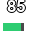
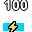
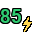
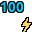
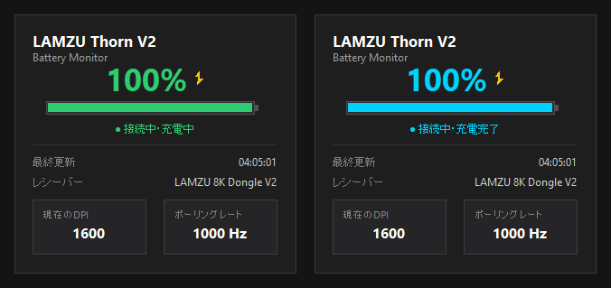

# LAMZU Thorn V2 Battery Monitor

LAMZU Thorn V2（LAMZU 8K Dongle V2 接続）のバッテリー残量をWindows上で常駐監視するための軽量システムトレイアプリケーションです。

公式Webドライバーを常時開くことなく、USB HID通信から直接バッテリー残量・充電状態・DPI・ポーリングレートを取得し、タスクトレイおよびステータスパネルにリアルタイムで表示します。

---

## 主な機能と表示デザイン

### 1. 3種類のトレイアイコンデザイン

タスクトレイの右クリックメニュー（「アイコンデザイン」）から、好みに応じた3種類のデザインを即時切り替え可能です。

| デザイン | 通常時 (85%) | 充電中 (⚡ 85%) | 充電完了 (⚡ 100%) | 特徴 |
| :---: | :---: | :---: | :---: | :--- |
| **数字+バッテリー表示**<br>(デフォルト) |  |  |  | 上部に数値、下部に横長バッテリーゲージを併記。残量と視覚ゲージを同時に確認できます。 |
| **数字のみ** |  |  |  | バッテリー外枠を排し数値を最大化。充電中は右下にゴールドの⚡マークを表示します。 |
| **バッテリーのみ** |  |  |  | 数値なしの横長ゲージ表示。充電中は中央にスリムな⚡マークを表示します。 |

#### ステータスごとの表示カラー変化
- **通常動作**: 残量パーセンテージに応じてカラーが自動変化（51–100%: 緑 `#2ECC71`、21–50%: 橙 `#F39C12`、0–20%: 赤 `#E74C3C`、未取得: 灰 `#95A5A6`）
- **充電中 (0x04)**: 残量色を維持したまま、ゴールドの⚡マーク（`#F1C40F`）を表示
- **充電完了 (0x02)**: 100%満充電に達した際、水色/シアン（`#00D2FF`）＋ゴールドの⚡マークを表示
- **スリープ推測 / 通信途絶**: 15秒間通信が途絶えた場合、最後の残量を保持したままアイコンを半透明減衰表示
- **ドングル切断**: 赤色の `X` アイコン表示

---

### 2. 左クリックで開くステータスパネル

トレイアイコンを**左クリック**すると、画面端（タスクバー近傍）にダークテーマのステータスパネルが表示されます。

<p align="center">
  
</p>

- **大きな残量表示 & 横長バッテリーゲージ**: 残量・充電・充電完了ステータスに応じたカラーで即座に状況を把握できます。
- **オンデマンド DPI / ポーリングレート取得**: パネル表示時にバックグラウンドで安全に問い合わせを行い、3点ドットローディングアニメーションを経て現在のDPIとポーリングレートを表示します。
- **クリック外れ自動非表示**: パネル外をクリックするか Esc キーを押すと瞬時に非表示になります。

---

### 3. その他の便利機能

1. **低バッテリー通知（トースト通知）**
   - バッテリー残量20%以下（低残量警告）および10%以下（緊急警告）でWindowsトースト通知を発報。
   - 充電回復後の自動再アーム、重複通知防止、およびメニューからのテスト通知機能を搭載。
2. **Windows自動起動対応**
   - 右クリックメニューから「Windows起動時に自動起動」の有効/無効をワンクリックで切り替え可能（管理者権限不要。設定はHKCU Runレジストリに登録され、`config.json` には保存されません）。
3. **公式Webドライバー連携**
   - 右クリックメニューから「LAMZU Auroraを開く」を選択すると、既定のブラウザーで公式Webドライバー（LAMZU Aurora）を直接起動。
4. **設定の永続化と二重起動防止**
   - 選択したアイコンデザイン、通知設定をローカル設定ファイル (`config.json`) にアトミック保存。
   - Windows Named Mutexによる二重起動防止機能を内蔵。

---

## 動作環境・対象デバイス

- **対応OS**: Windows 11 (64-bit 実機動作確認済み) / Windows 10 (64-bit 未検証・互換動作想定)
- **対象デバイス**: LAMZU Thorn V2（LAMZU 8K Dongle V2 経由での接続）
  - Vendor ID (VID): `0x37B0`
  - Product ID (PID): `0x002E`
- **Python環境**（ソースコードから実行・開発する場合）:
  - Python 3.13 64-bit 推奨（Python 3.11 以上）

---

## 使用方法

### 1. 配布用EXE（単一実行ファイル）から起動する場合

1. [Releases](https://github.com/jun0b/LAMZU-Thorn-V2-Battery-Monitor/releases) より `LAMZU-Thorn-Battery-Monitor.exe` をダウンロードします。
2. 任意のフォルダーに配置してダブルクリックで実行します。
3. タスクバー右下の通知領域（システムトレイ）にアイコンが常駐します。
4. トレイアイコンを**左クリック**するとステータスパネルが表示され、**右クリック**すると各種設定メニューが表示されます。

> [!NOTE]
> **Windows SmartScreen 警告について**  
> 本バイナリは個人開発によるオープンソース配布物であり、高額な商用コード署名証明書による署名を行っていません。初回の実行時に Windows SmartScreen により「Windows によって PC が保護されました」という警告画面が表示される場合があります。その際は「詳細情報」をクリックし、「実行」を選択してください。

### 2. Pythonソースコードから実行する場合

#### 依存ライブラリのインストール
```powershell
pip install -r requirements.txt
```

#### アプリケーションの起動
```powershell
# 通常の実機監視モード
python app.py

# 実機なしで動作を確認できるデモモード（シミュレーション）
python app.py --demo

# 詳細ログを出力するデバッグモード
python app.py --debug
```

#### CLIツールによるHID通信診断
```powershell
# 接続されているLAMZU HIDデバイスを一覧表示
python probe_hid.py --list

# 受信パケットのリアルタイム監視
python probe_hid.py --read --seconds 30
```

---

## ソースコードからのビルド・再結合手順

本プロジェクトは、外部依存のない単一実行可能ファイル（OneFile EXE）のビルド手順書および GNU LGPL-3.0 に基づく改変ライブラリ再結合手順を完全に公開しています。

詳細な手順については [docs/BUILD_FROM_SOURCE.md](docs/BUILD_FROM_SOURCE.md) を参照してください。

---

## 設定ファイルおよびログの保存場所

ユーザー設定および実行ログは、Windowsのユーザー個別データ領域に自動生成・保存されます。

- **設定ファイル**:
  `%LOCALAPPDATA%\LAMZUThornBatteryMonitor\config.json`
  （アイコンデザインおよび通知設定などのアプリケーション設定）
- **Windows自動起動設定**:
  レジストリ `HKEY_CURRENT_USER\Software\Microsoft\Windows\CurrentVersion\Run`（値名: `LAMZUThornBatteryMonitor`）
  ※自動起動設定はWindowsレジストリに登録され、`config.json` には保存されません。
- **ログファイル**:
  `%LOCALAPPDATA%\LAMZUThornBatteryMonitor\logs\app.log`
  （最大1MB × 3世代の自動ローテーション）

---

## 単体テストの実行

本プロジェクトには、プロトコル解析、状態遷移、UI描画、設定永続化、自動起動、多重起動防止などを検証する単体テスト（156件）が含まれています。

```powershell
python -m unittest discover -s tests -p "test_*.py"
```

---

## 注意事項・既知の制限および未検証事項

1. **非公式ソフトウェアについて**
   - 本ツールは個人有志が作成した非公式のオープンソースソフトウェアです。LAMZU社およびその関連企業とは一切関係ありません。
2. **読み取り専用設計の厳守**
   - 本アプリケーションはマウスのファームウェア書き換えやDPI・ポーリングレートの変更操作を一切行いません（設定変更は公式Webドライバー LAMZU Aurora で行ってください）。
3. **USB充電ケーブル取り外し後の充電中表示（既知の制限）**
   - マウスのUSB給電ケーブルを取り外した後も、ステータスパネルやトレイアイコンに充電中表示（⚡マーク）が継続して残る場合があります。
   - この現象は本アプリケーション固有のものではなく、同様の状況において**LAMZU 8KドングルのLEDインジケーター**および**LAMZU公式Webドライバー（LAMZU Aurora）**上でも充電中表示のまま継続することが実機検証により確認されています（マウスの移動やクリック操作を行っても即時には解除されない場合があります）。
   - 本アプリケーションはデバイスおよびドングルから受信した最新のHIDステータスを忠実に反映する設計となっており、現時点で原因は未確定（ハードウェア・ドングル・ファームウェア側の挙動である可能性）のため、強制的な解除処理などは行っていません。
4. **未検証の接続形態・環境**
   - **マウス本体の直接有線接続**: 本アプリケーションは LAMZU 8K Dongle V2 経由の無線接続を対象にプロトコル解析・設計を行っています。マウス本体を有線接続した場合の挙動は未検証です。
   - **標準1Kドングル・他の4K/8Kドングル**: 付属の標準1Kドングルや他モデル用ドングルでの動作は未検証です。
   - **ファームウェアバージョン差異**: 将来のファームウェア更新によりHID通信仕様が変更された場合、正確な値が取得できなくなる可能性があります。
   - **長期間連続稼働**: 数日〜数週間に及ぶ超長期の連続稼働テストは未実施です。

---

## ライセンス・第三者権利表示

- **本体ライセンス**: **MIT License**（詳細: [LICENSE](LICENSE)）
- **アプリアイコン**: 本プロジェクト独自作成（MIT Licenseに包含）
- **第三者ライブラリ**: 本アプリケーションは `pystray` (LGPL-3.0)、`hidapi` (BSD-style)、`Pillow` (HPND)、`winotify` (MIT)、`psutil` (BSD 3-Clause) などの優れたオープンソースソフトウェアを使用しています。
  - 各ライブラリのライセンス条文、著作権表示、および LGPL-3.0 対応に関する技術的留意事項については [docs/THIRD_PARTY_LICENSES.md](docs/THIRD_PARTY_LICENSES.md) を参照してください。
  - LGPL-3.0 に基づく改変版ライブラリの再結合手順については [docs/BUILD_FROM_SOURCE.md](docs/BUILD_FROM_SOURCE.md) を参照してください。
